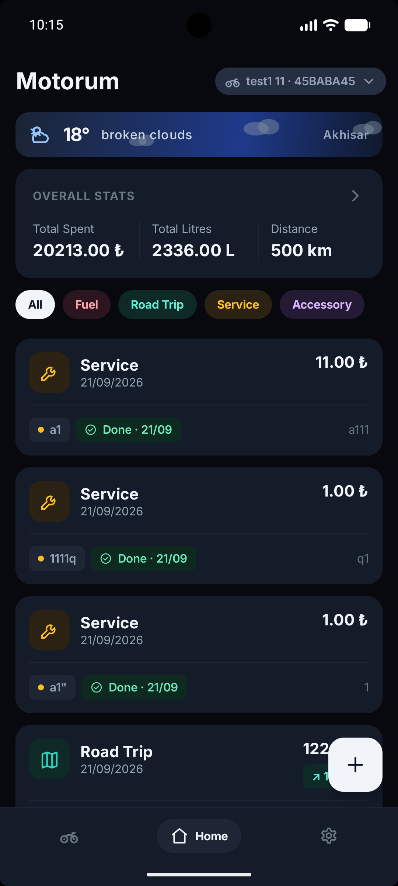
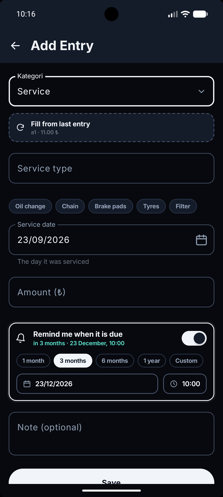
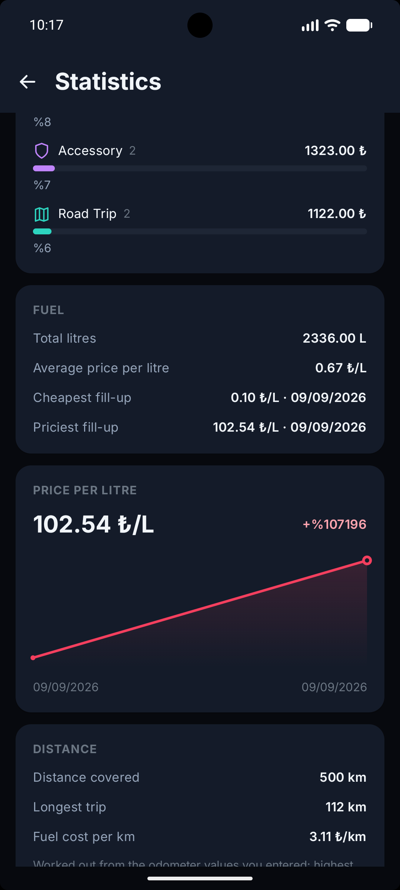
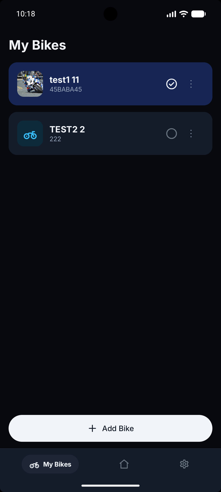
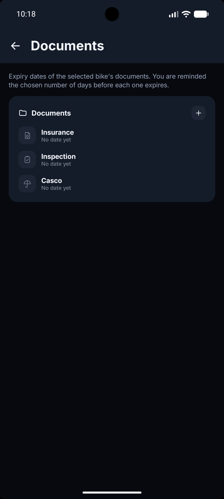
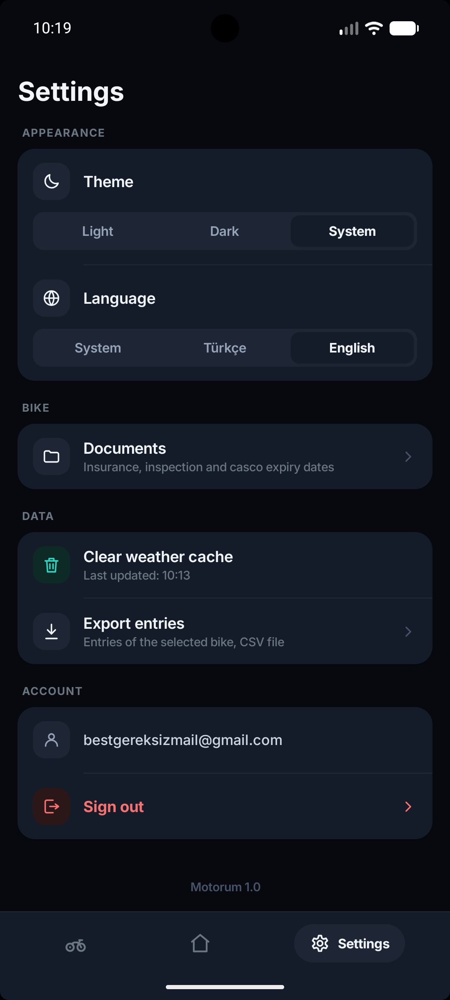
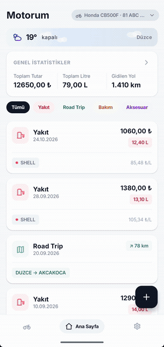

# Motorum

Motosiklet sahipleri için gider ve bakım takip uygulaması. Yakıt, bakım, aksesuar ve
gezi harcamalarını tek yerde toplar; bakım zamanı geldiğinde hatırlatır, sigorta ve
muayene gibi belgelerin bitiş tarihini takip eder.

Jetpack Compose ile yazılmış, Firebase üzerinde çalışan tek modüllü bir Android uygulaması.


---

## Ekran görüntüleri

| Ana sayfa | Kayıt ekle | İstatistik |
|:---:|:---:|:---:|
|  |  |  |
| **Motorlarım** | **Belgeler** | **Ayarlar** |
|  |  |  |
<p align="center">
  
</p>

Uygulama açılış animasyonuyla başlıyor, ilk kurulumda tanıtım ekranları ve giriş / üye ol
adımlarından geçiyor. Ana bölge üç sekmeden oluşuyor: **Ana Sayfa** (kayıt listesi, özet
şerit, hava durumu, hatırlatma paneli), **Motorlarım** (motosiklet listesi ve detayı) ve
**Ayarlar**. İstatistik, Belgeler, Kayıt Ekle ve Kayıt Detay ekranlarına buradan geçiliyor.

---

## Özellikler

**Birden fazla motosiklet**
Her motosiklet kendi kayıtlarını, belgelerini ve fotoğrafını tutar. Üst bardaki seçiciden
motorlar arasında geçiş yapılır; ekranlar seçili motora göre yenilenir.

**Dört kayıt türü**
Her tür kendi alanlarıyla geliyor:

| Tür | Tuttuğu bilgiler |
|---|---|
| Yakıt | Litre, birim fiyat, sayaç, istasyon |
| Road Trip | Güzergâh, mesafe, mola noktaları ve mola harcamaları |
| Bakım | Bakım kalemi, sayaç, hatırlatma tarihi |
| Aksesuar | Ürün, marka, tutar |

Kayıtlar kaydırılarak silinir ve silme işlemi geri alınabilir; bir kaydı şablon olarak
kopyalayıp yeni kayıt açmak mümkündür.

**Bakım hatırlatmaları**
Bakım kaydına hatırlatma tarihi verilir, zamanı gelince bildirim düşer. Bildirimden
uygulamaya girildiğinde doğrudan ilgili kaydın paneli açılır: *yaptırdım*, *bir hafta ertele*
veya *vazgeç*. Alarmlar cihaz yeniden başlatıldığında kendini yeniden kurar ve buluttaki
kayıtlarla eşitlenir.

**Belgeler**
Sigorta, muayene, kasko ve serbest belgeler için bitiş tarihi takibi. Yaklaşan ve süresi
geçmiş belgeler ana sayfada öne çıkar.

**İstatistik**
Dönem bazlı toplam harcama, kategori dağılımı, gidilen yol ve yakıt birim fiyatının
zaman içindeki değişimi.

**Hava durumu**
Konuma göre güncel hava durumu kartı; sürüş için uygunluk yorumu ve hava durumuna göre
değişen animasyon. Veri OpenWeather'dan çekilir, uygulama diliyle aynı dilde istenir ve
önbelleğe alınır.

**Dil ve tema**
Türkçe ve İngilizce. Dil hem sistemden hem uygulama içinden değiştirilebilir
(Android'in *per-app language* özelliği). Tema açık / koyu / sistem olarak seçilir;
tüm ekranlar koyu temaya göre ayrıca tasarlandı.

**Dışa aktarma**
Seçili motorun tüm kayıtları CSV olarak dışa aktarılır. Sütun değerleri dilden bağımsız
sabittir, böylece farklı zamanlarda alınan dosyalar karşılaştırılabilir.

---

## Teknoloji

| Alan | Kullanılan |
|---|---|
| Dil / derleme | Kotlin 2.4.20, AGP 9.3.2, KSP |
| Arayüz | Jetpack Compose (BOM 2026.09.00), Material 3 |
| Gezinme | Navigation Compose, predictive back destekli geçişler |
| Bağımlılık enjeksiyonu | Hilt 2.60.1 |
| Kimlik / veri | Firebase Auth + Cloud Firestore (BOM 34.19.0) |
| Ağ | Retrofit 3 + kotlinx.serialization |
| Yerel ayar | DataStore Preferences |
| Konum | Play Services Location |
| Animasyon | Compose Animation, Lottie |
| Dil desteği | AppCompat (`AppCompatDelegate.setApplicationLocales`) |

minSdk 29 (Android 10), compileSdk / targetSdk 37.

---

## Mimari

Tek modül, sorumluluğa göre bölünmüş paketler. Ekranlar `feature`, veri kaynakları `data`,
her yerde kullanılan altyapı `core` altında; `model` ikisinin de bağımlı olduğu saf veri
katmanı.

```
com.oguzhanp.motorum
├── model/                  Veri sınıfları (Kayit, Motor, Belge, Kategori...)
├── di/                     Hilt modülleri
├── core/
│   ├── tasarim/            Tema, renk, tipografi, ortak bileşenler
│   ├── navigation/         Routes, NavHost, alt bar, ekran geçişleri
│   ├── izin/               Bildirim ve konum izin akışları
│   └── util/               Biçimlendirme, dil ayarı, ölçüler
├── data/
│   ├── kayit/  motor/  belge/  hatirlatma/
│   ├── hava/   kimlik/  ayarlar/
│   └── ortak/              Koleksiyon adları, hata eşlemesi, ağ durumu
└── feature/
    ├── acilis/  onboarding/  kimlik/
    ├── anasayfa/  hava/  istatistik/  belge/  motorlarim/  ayarlar/
    └── kayit/{ekle, detay, form, bilesenler}
```

Ekranlar `ViewModel` + tek bir `UiState` akışı üzerinden çalışıyor; veri erişimi
`Depo` (repository) sınıflarının arkasında. Arayüz katmanı Firestore'u doğrudan görmüyor.

### Veri düzeni

Firestore'da her şey kullanıcının kendi ağacının altında duruyor:

```
users/{uid}/motorlar/{motorId}
users/{uid}/motorlar/{motorId}/kayitlar/{kayitId}
users/{uid}/motorlar/{motorId}/belgeler/{belgeId}
users/{uid}/motorlar/{motorId}/medya/fotograf
```

---

## Kurulum

### 1. Firebase

Firebase Console'da bir proje oluşturun ve Android uygulaması ekleyin
(paket adı: `com.oguzhanp.motorum`).

- **Authentication** → *E-posta/Şifre* yöntemini etkinleştirin
- **Firestore Database** → veritabanını oluşturun
- İndirdiğiniz `google-services.json` dosyasını `app/` klasörüne koyun

> Bu dosya depoya dâhil değildir; `.gitignore` içinde listelenmiştir.

Firestore kurallarını aşağıdaki gibi ayarlayın — her kullanıcı yalnızca kendi verisine
erişebilir, yazılmayan diğer tüm yollar varsayılan olarak reddedilir:

```
rules_version = '2';
service cloud.firestore {
  match /databases/{database}/documents {
    match /users/{uid}/{belge=**} {
      allow read, write: if request.auth != null && request.auth.uid == uid;
    }
  }
}
```

### 2. Hava durumu anahtarı

[OpenWeather](https://openweathermap.org/api) üzerinden ücretsiz bir API anahtarı alın ve
proje kökündeki `local.properties` dosyasına ekleyin:

```properties
OPENWEATHER_KEY=buraya_anahtariniz
```

Bu dosya da depoya girmez. Anahtar verilmezse uygulama derlenir ve çalışır, yalnızca hava
durumu kartı veri çekemez.

### 3. Çalıştırma

Projeyi Android Studio ile açın, Gradle senkronizasyonunu bekleyin ve çalıştırın.
JDK 11 hedefleniyor; Android Studio'nun kendi JBR'si yeterli.

---

## Yol haritası

- [ ] Çevrimdışı mod ve yerel önbellek (Room)
- [ ] Bakımlar için ayrı bir özet sayfası
- [ ] Ana ekran widget'ı
- [ ] Yıl özeti
- [ ] Tablet ve katlanabilir cihazlar için uyarlanabilir yerleşim

---

## Notlar

Uygulama kişisel bir öğrenme projesi olarak geliştiriliyor; arayüz metinleri ve kod
içindeki açıklamalar Türkçedir. Hata bildirimi ve öneriler için issue açabilirsiniz.
